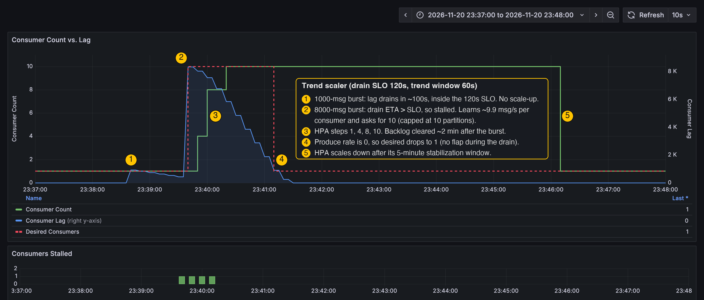

# KEDA Kafka Lag Trend Scaler

**Autoscaling for Kafka consumers that asks the right question: can they catch up?**

---

## What is this?

An **alternative to [KEDA's built-in Apache Kafka scaler](https://keda.sh/docs/2.18/scalers/apache-kafka/)**. It scales on the *trend* of consumer lag, not its size.

A backlog is only a problem if your consumers can't work through it in time. 50k messages of lag that's falling fast is fine. 2k of lag that never shrinks means you're under-provisioned, and it will only get worse.

- **Static threshold scalers** (KEDA's Kafka scaler) react to *how big* lag is. Any burst scales you up, even one you'd have drained in a minute.
- **"Sustained lag" rules** (lag > X for N minutes) are the same thing with HPA stabilization on top. They still can't tell a backlog that's draining from one that isn't.
- **This scaler** fits a line to lag over a short window, projects when the backlog will hit zero, and scales only when that projection misses your SLO. It then sizes the consumer group from measured throughput, not guesswork.

---

## How it works (simple version)

```
Lag falling fast enough to clear within maxDrainSeconds?   → do nothing
Lag flat, rising, or falling too slowly?                   → consumers can't catch up → scale
How many?  (produce rate + backlog / maxDrainSeconds) ÷ per-consumer throughput
```

Per-consumer throughput is **learned**. While there's a backlog, consumers are working flat out, so the observed consume rate divided by the consumer count is what one consumer can actually do.

---

## Quick Start

The scaler runs as its own Deployment (see [`examples/k8s/deploy/lag-scaler.yaml`](./examples/k8s/deploy/lag-scaler.yaml)) and is tuned with env vars:

```yaml
env:
  - { name: KAFKA_TOPIC,          value: "my-topic" }
  - { name: KAFKA_GROUP_ID,       value: "my-consumer-group" }
  - { name: MAX_DRAIN_SECONDS,    value: "300" }   # SLO: backlog must clear within 5 min
  - { name: TREND_WINDOW_SECONDS, value: "120" }   # judge the trend over 2 min
```

Point a ScaledObject at it:

```yaml
apiVersion: keda.sh/v1alpha1
kind: ScaledObject
metadata:
  name: kafka-consumer-scaler
spec:
  scaleTargetRef:
    name: my-kafka-consumer
  minReplicaCount: 1
  maxReplicaCount: 12
  triggers:
    - type: external
      metadata:
        scalerAddress: lag-scaler.default.svc.cluster.local:50051
        topic: my-topic
        consumerGroup: my-consumer-group
```

The scaler reports the **desired consumer count** as its metric, with a target of 1, so HPA scales straight to that number.

---

## The decision, step by step

On every KEDA poll, over the last `trendWindowSeconds` of scrapes:

| Step | What | How |
|---|---|---|
| 1 | Lag trend | least-squares slope of total lag (msgs/sec) |
| 2 | Produce / consume rate | slopes of Σ end offsets / Σ committed offsets |
| 3 | Drain ETA | `lag / -slope`; infinite if lag isn't falling |
| 4 | **Stalled?** | `lag ≥ minLag` **and** `drainETA > maxDrainSeconds` |
| 5 | Capacity | if lag stayed above `minLag` the whole window and the consumer count didn't change: `consumeRate / consumers` (EWMA) |
| 6 | Need | `ceil(headroom × (produceRate + lag / maxDrainSeconds) / capacity)` |
| 7 | Report | stalled → `max(need, consumers + 1)`; healthy → `min(need, consumers)`; clamped to `[minConsumers, min(maxConsumers, partitions)]` |

Guards:
- **Warm-up.** The scaler holds the current count until it has enough stable history: after startup, a rebalance, a partition change, or the start of a new lag episode.
- **Bursts.** The instant jump of a burst is never fitted as a rising trend. While lag is above `minLag`, only the current episode is used.
- **Offset resets.** Committed offsets moving backwards skip capacity learning for that window.

### Why it doesn't flap

The classic failure of trend-based scaling: scale up → lag falls → the signal turns off → scale down → lag rises → repeat. Here, a healthy trend only stops *scale-up*. The reported count is still `produce rate / capacity`, the real steady-state need. So replicas hold after catching up, and only come down when the produce rate actually drops.

### Example

One consumer doing ~10 msg/s, `maxDrainSeconds: 120`, `headroom: 1.2`:

| Situation | Lag trend | Drain ETA | Decision |
|---|---|---|---|
| 1000-msg burst | −10/s | ~100s | ✅ healthy, stay at 1 |
| 8000-msg burst | −10/s | ~800s | ⚠️ stalled → capacity 10/s → need ≈ ⌈1.2 × ~7000/120 / 10⌉ ≈ 7 (capped at partition count) |
| Producer at 25 msg/s, sustained | +15/s | ∞ | ⚠️ stalled → need ≈ ⌈1.2 × (25 + lag/120) / 10⌉ |
| After scale-up, producer still 25 msg/s | falling | < 120s | ✅ healthy, hold at ⌈1.2 × 25/10⌉ = 3 once drained |
| Producer drops to 5 msg/s | flat ~0 | 0 | ✅ healthy, scale down to 1 |

---

## Test Results



> This run predates the trend model. It was taken with the earlier "lag above threshold for N seconds" scaler and needs re-running against the current one. See [docs/local-test.md](./docs/local-test.md).

---

## Configuration Reference

| Parameter (env / metadata) | Default | What it does |
|---|---|---|
| `MAX_DRAIN_SECONDS` / `maxDrainSeconds` | `300` | The SLO. Backlog must be projected to clear within this. Lower = more aggressive |
| `TREND_WINDOW_SECONDS` / `trendWindowSeconds` | `120` | History used for the fit. Longer = steadier but slower |
| `MIN_LAG` / `minLag` | `100` | Lag below this is noise: never stalled, scaler inactive |
| `HEADROOM` / `headroom` | `1.2` | Multiplier on required throughput |
| `PER_CONSUMER_RATE` / `perConsumerRate` | learned | Fixed msgs/sec per consumer, if you'd rather not learn it |
| `CAPACITY_SMOOTHING` / `capacitySmoothing` | `0.3` | EWMA alpha for learned capacity |
| `MIN_CONSUMERS` / `minConsumers` | `1` | Floor on reported consumers |
| `MAX_CONSUMERS` / `maxConsumers` | partitions | Ceiling on reported consumers (never above partition count) |
| `MIN_SAMPLES` / `minSamples` | `6` | Minimum scrapes before deciding |
| `SAMPLING_INTERVAL` / `samplingInterval` | `10` | Seconds between scrapes |

Full details, including env-vs-metadata, are in [scaler/README.md](./scaler/README.md).

### Tuning presets

**Latency-sensitive** (react fast, over-provision a little):
```
MAX_DRAIN_SECONDS=60  TREND_WINDOW_SECONDS=60  HEADROOM=1.5
```

**Balanced** (defaults):
```
MAX_DRAIN_SECONDS=300  TREND_WINDOW_SECONDS=120  HEADROOM=1.2
```

**Cost-optimized** (tolerate long backlogs):
```
MAX_DRAIN_SECONDS=1800  TREND_WINDOW_SECONDS=300  HEADROOM=1.0
```

---

## Architecture

```
┌─────────────────┐
│  Kafka Cluster  │
└────────┬────────┘
         │ end offsets, committed offsets, group members
         ▼
┌─────────────────────┐
│  Scraper            │◄─── one Batch per tick (summed over partitions)
└─────────┬───────────┘
          ▼
┌─────────────────────┐
│  Sliding Window     │◄─── last trendWindow (+ slack) of batches
└─────────┬───────────┘
          ▼
┌─────────────────────┐
│  Trend Evaluator    │◄─── slope fit → drain ETA → stalled? → capacity → desired
└─────────┬───────────┘
          ▼
┌─────────────────────┐
│ KEDA External       │◄─── IsActive = lag ≥ minLag
│ Scaler (gRPC)       │     GetMetrics = desired consumers (target 1)
└─────────┬───────────┘
          ▼
┌─────────────────────┐
│ Kubernetes HPA      │
└─────────────────────┘
```

---

## Comparison with KEDA's built-in Kafka scaler

| | KEDA Kafka scaler | This scaler |
|---|---|---|
| Signal | current lag vs. threshold | lag trend vs. drain-time SLO |
| Burst that drains in time | scales up | ignores it |
| Small lag that never drains | ignored if under threshold | scales (if above `minLag`) |
| Replica count | `lag / lagThreshold` | `produce rate + backlog/SLO` ÷ measured per-consumer throughput |
| After catching up | lag → 0 → scales down → may re-lag | holds at what the produce rate needs |
| Tuning knob | a lag number you have to guess | a drain time you can read off your SLO |

---

## References & prior art

1. **"Consumer Throughput: Kafka Time-Lag as an Uber Metric for SLO Monitoring"** by Deby Roth: lag is best read as time-to-process, not a message count.
2. **Google SRE Book**, chapter on autoscaling: hysteresis and temporal smoothing.
3. **LinkedIn Burrow**: evaluates consumer status from the offset trend over a window, not single snapshots.

See the [whitepaper](./docs/whitepaper.md) for the full design rationale.

---

## License

[License TBD]
