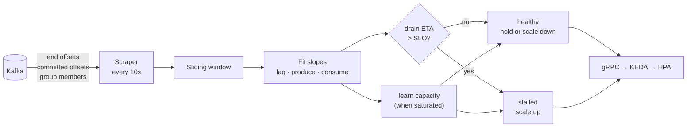

<div align="center">

# KEDA Kafka Lag Trend Scaler

**Scale Kafka consumers on whether they can _catch up_, not on how scary the lag number looks.**

[](https://github.com/sarkarshuvojit/keda-kafka-lag-trend-scaler/actions/workflows/ci.yml)
[](https://github.com/sarkarshuvojit/keda-kafka-lag-trend-scaler/actions/workflows/ci.yml)
[](./scaler/pkg/kafka/client_integration_test.go)
[](./scaler/go.mod)
[](https://keda.sh/docs/latest/concepts/external-scalers/)
[](./.github/workflows/release.yml)


</div>

> **50,000 messages of lag that's draining fast is fine.
> 2,000 that never moves is an incident.**
> Threshold scalers can't tell the difference. This one can.

---

## The 60-second version

KEDA's [built-in Kafka scaler](https://keda.sh/docs/latest/scalers/apache-kafka/) scales on **how big** lag is. Adding "…for N minutes" only makes it slower; it still can't see *direction*. So every burst you'd have drained in a minute triggers a scale-up, and a small backlog that's silently growing slips under the threshold.

This scaler watches the **trend** instead:

```text
Is lag falling fast enough to clear within your SLO?   → leave it alone
Is it flat, rising, or falling too slowly?             → consumers can't catch up → scale
To how many?   (produce rate + backlog ÷ SLO) ÷ what one consumer can actually do
```

That last number isn't a guess. **Per-consumer throughput is learned from your own consumers.** While there's a backlog they're working flat out, so `consume rate ÷ consumers` is their real capacity.

You tune it with **a time** ("drain any backlog within 5 minutes"), which you can read straight off an SLO. You don't tune it with a message count you'd have to retune every time payloads or traffic change.

---

## Why it's different

| | KEDA Kafka scaler | "Lag > X for N min" | **Lag trend scaler** |
|---|---|---|---|
| Signal | current lag vs. threshold | same, held for N min | **lag slope vs. drain-time SLO** |
| Burst that drains in time | 🔺 scales up | 🔺 scales up (later) | ✅ ignores it |
| Small backlog that never drains | 🙈 ignored if under threshold | 🙈 ignored | ✅ scales |
| Huge lag falling at 1 msg/s | scales | scales | ✅ scales (ETA ≫ SLO) |
| How many replicas | `lag ÷ lagThreshold` | same | **`(produce + backlog/SLO) ÷ learned capacity`** |
| After catching up | lag → 0 → scales down → re-lags | same | ✅ holds at what the produce rate needs |
| What you tune | a lag number you guess | two guesses | **a drain time from your SLO** |

---

## See it work

The hero chart is a real run on minikube: one consumer (~10 msg/s), 10 partitions, `MAX_DRAIN_SECONDS=120`, driven by [`load-test.sh`](./load-test.sh).

1. **1000-msg burst.** It drains in ~100s, inside the SLO, so nothing happens.
2. **8000-msg burst.** The scaler flags *stalled* within one poll, learns **9.9 msg/s per consumer**, and asks for 10 (the partition cap).
3. HPA steps **1 → 4 → 8 → 10**, and the backlog is gone about 2 minutes after the burst.
4. The produce rate drops to 0, so desired drops to 1. It doesn't flap during the drain.
5. HPA scales down after its 5-minute stabilization window.

Here is the scaler's own reasoning, straight from its logs:

```text
GetMetrics: desired=10 stalled=true lag=8343 slope=104.4/s produce=114.3/s consume=9.9/s drainETA=+Infs capacity=9.9/s consumers=1 desired=10
GetMetrics: desired=1  stalled=false lag=902 slope=-98.7/s produce=0.0/s consume=98.7/s drainETA=9s capacity=9.9/s consumers=10 desired=1
```

Reproduce it yourself (needs minikube + KEDA):

```bash
./start.sh && ./load-test.sh
```

The full timeline and config are in [docs/local-test.md](./docs/local-test.md).

---

## Quick start

**1. Run the scaler** next to your consumers (full manifest: [`examples/k8s/deploy/lag-scaler.yaml`](./examples/k8s/deploy/lag-scaler.yaml)):

```yaml
env:
  - { name: KAFKA_BROKERS,        value: "kafka:9092" }
  - { name: KAFKA_TOPIC,          value: "orders" }
  - { name: KAFKA_GROUP_ID,       value: "order-workers" }
  - { name: MAX_DRAIN_SECONDS,    value: "300" }   # any backlog must clear within 5 min
  - { name: TREND_WINDOW_SECONDS, value: "120" }   # judge the trend over 2 min
```

**2. Point a ScaledObject at it.**

```yaml
apiVersion: keda.sh/v1alpha1
kind: ScaledObject
metadata:
  name: order-workers
spec:
  scaleTargetRef:
    name: order-workers
  minReplicaCount: 1
  maxReplicaCount: 12
  triggers:
    - type: external
      metadata:
        scalerAddress: lag-scaler.default.svc.cluster.local:50051
```

The scaler reports the **desired consumer count** as its metric with a target of `1`, so HPA scales straight to that number. Images for tagged releases are published to `ghcr.io/sarkarshuvojit/lag-trend-scaler` (amd64 + arm64).

---

## How it decides



<details>
<summary><b>The decision, step by step</b></summary>

On every KEDA poll, over the last `trendWindowSeconds` of scrapes:

| Step | What | How |
|---|---|---|
| 1 | Lag trend | least-squares slope of total lag (msgs/sec) |
| 2 | Produce / consume rate | slopes of Σ end offsets / Σ committed offsets |
| 3 | Drain ETA | `lag / -slope`; infinite if lag isn't falling |
| 4 | **Stalled?** | `lag ≥ minLag` **and** `drainETA > maxDrainSeconds` |
| 5 | Capacity | if lag stayed above `minLag` the whole window and the consumer count didn't change: `consumeRate / consumers` (EWMA) |
| 6 | Need | `ceil(headroom × (produceRate + lag / maxDrainSeconds) / capacity)` |
| 7 | Report | stalled → `max(need, consumers + 1)`; healthy → `min(need, consumers)`; clamped to `[minConsumers, min(maxConsumers, partitions)]` |

Least-squares slopes instead of endpoint differences make it robust to scrape jitter, uneven spacing and consumer commit batching.

</details>

<details>
<summary><b>Guards against the classic failure modes</b></summary>

- **Flapping.** Trend scalers usually do scale up → lag falls → signal off → scale down → lag rises → repeat. Here a healthy trend only blocks *scale-up*. The target stays at `produce rate ÷ capacity`, so replicas hold after catching up and only fall when the produce rate does.
- **Bursts.** The vertical jump of a burst is never fitted as a "rising trend". While lag is above `minLag`, only the current lag episode is fitted.
- **Rebalances and repartitions.** The fit only uses scrapes with the same consumer and partition count as the latest one. Until it has enough history again, the scaler is *warming up* and repeats its last decision. Rollout surges can't ratchet the count up.
- **Idle groups.** No production and no backlog means need = 0, so the group scales down to `minConsumers` even before any capacity has been learned.
- **Offset resets.** Committed offsets moving backwards skip capacity learning for that window.
- **Partition cap.** It never asks for more consumers than partitions, since the extras would sit idle.

</details>

<details>
<summary><b>Worked example</b></summary>

One consumer doing ~10 msg/s, `maxDrainSeconds: 120`, `headroom: 1.2`:

| Situation | Lag trend | Drain ETA | Decision |
|---|---|---|---|
| 1000-msg burst | −10/s | ~100s | ✅ healthy, stay at 1 |
| 8000-msg burst | −10/s | ~800s | ⚠️ stalled → capacity 10/s → need ≈ ⌈1.2 × ~7000/120 / 10⌉ ≈ 7 |
| Producer at 25 msg/s, sustained | +15/s | ∞ | ⚠️ stalled → need ≈ ⌈1.2 × (25 + lag/120) / 10⌉ |
| After scale-up, producer still 25 msg/s | falling | < 120s | ✅ healthy, hold at ⌈1.2 × 25/10⌉ = 3 once drained |
| Producer drops to 5 msg/s | flat ~0 | 0 | ✅ healthy, scale down to 1 |

</details>

---

## Configuration

| Env var | Default | What it does |
|---|---|---|
| `MAX_DRAIN_SECONDS` | `300` | **The SLO.** Backlog must be projected to clear within this. Lower = more aggressive |
| `TREND_WINDOW_SECONDS` | `120` | History used for the fit. Longer = steadier but slower |
| `MIN_LAG` | `100` | Lag below this is noise: never stalled, scaler inactive |
| `HEADROOM` | `1.2` | Multiplier on required throughput |
| `PER_CONSUMER_RATE` | learned | Fixed msgs/sec per consumer, if you'd rather not learn it |
| `CAPACITY_SMOOTHING` | `0.3` | EWMA alpha for learned capacity |
| `MIN_CONSUMERS` / `MAX_CONSUMERS` | `1` / partitions | Clamp on the reported count |
| `MIN_SAMPLES` | `6` | Minimum scrapes before deciding |
| `SAMPLING_INTERVAL` | `10` | Seconds between scrapes |
| `KAFKA_BROKERS`, `KAFKA_TOPIC`, `KAFKA_GROUP_ID` | | What to watch |

Every value is validated at startup. Full reference: [scaler/README.md](./scaler/README.md).

| Preset | `MAX_DRAIN_SECONDS` | `TREND_WINDOW_SECONDS` | `HEADROOM` |
|---|---|---|---|
| ⚡ Latency-sensitive | 60 | 60 | 1.5 |
| ⚖️ Balanced (defaults) | 300 | 120 | 1.2 |
| 💸 Cost-optimized | 1800 | 300 | 1.0 |

---

## Observability

Everything behind a decision is exported on `:9090/metrics`, so you can always answer *"why did it scale?"*:

| Metric | Meaning |
|---|---|
| `kafka_lag_scaler_desired_consumers` | what the scaler asked KEDA for |
| `kafka_lag_scaler_stalled` / `_activations_total` | consumers can't catch up / count of stalls |
| `kafka_lag_scaler_drain_eta_seconds` | projected time to clear the backlog (`+Inf` if it isn't falling) |
| `kafka_lag_scaler_lag_slope` | msgs/sec; negative = draining |
| `kafka_lag_scaler_produce_rate` / `_consume_rate` | fitted rates, msgs/sec |
| `kafka_lag_scaler_consumer_capacity` | learned (or configured) per-consumer throughput |
| `kafka_lag_scaler_total_lag`, `_partition_lag`, `_consumer_count` | the raw inputs |
| `kafka_lag_scaler_warming_up`, `_active` | decision state |

The local stack ships a pre-built Grafana dashboard (the chart at the top).

---

## How it's tested

Every push and PR runs [CI](./.github/workflows/ci.yml):

- **Unit tests with the race detector:** the trend maths, config parsing, the gRPC server (including streaming), the scraper and the metrics.
- **Integration tests against a real Kafka 3.9 broker** (service container): actual topics, producers, committed offsets and group membership through the real client code.
- **Coverage across every hand-written package**, published as the badge above. Only generated protobuf code and `main`'s wiring are excluded.
- `gofmt` and `go vet` for both Go modules.
- **Both container images built** on every change.
- **All Kubernetes manifests validated** with kubeconform, including KEDA's `ScaledObject` schema.

Run the same suite locally:

```bash
cd scaler
make test                       # unit tests, no dependencies
docker run -d --rm -p 9092:9092 apache/kafka:3.9.0
make test-integration           # + real Kafka, with coverage
```

Releases: push a `v*` tag and the [release workflow](./.github/workflows/release.yml) reruns CI, publishes multi-arch images to GHCR, and creates a GitHub Release with generated notes.

---

## Known limitations

These are honest edges, not hidden ones:

- **Consumer count = group members, not pods.** Anything else in the same consumer group is counted too.
- **A second burst landing mid-drain** is read as produce rate (seen in the [test run](./docs/local-test.md#known-rough-edge-seen-in-this-run)), so it can overshoot until the partition cap. A robust slope estimator is the planned fix.
- **Config comes from the scaler's env vars.** `ScaledObject` trigger metadata isn't wired into the running server yet, so it's one scaler instance per topic and group.
- **Learned capacity lives in memory.** After a scaler restart it relearns at the next backlog, falling back to safe rules until then.

---

## Learn more

- [scaler/README.md](./scaler/README.md): deploy guide, full config, project layout
- [docs/whitepaper.md](./docs/whitepaper.md): design rationale
- [docs/local-test.md](./docs/local-test.md): the test run behind the chart

**Prior art:** Deby Roth, *"Kafka Time-Lag as an Uber Metric for SLO Monitoring"* (read lag as time, not a count) · Google SRE Book on autoscaling (hysteresis, smoothing) · LinkedIn **Burrow** (judge consumers by the offset trend over a window).

## License

License TBD.
